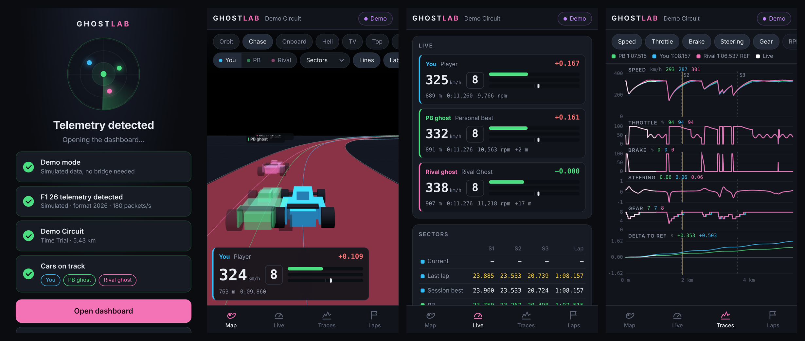
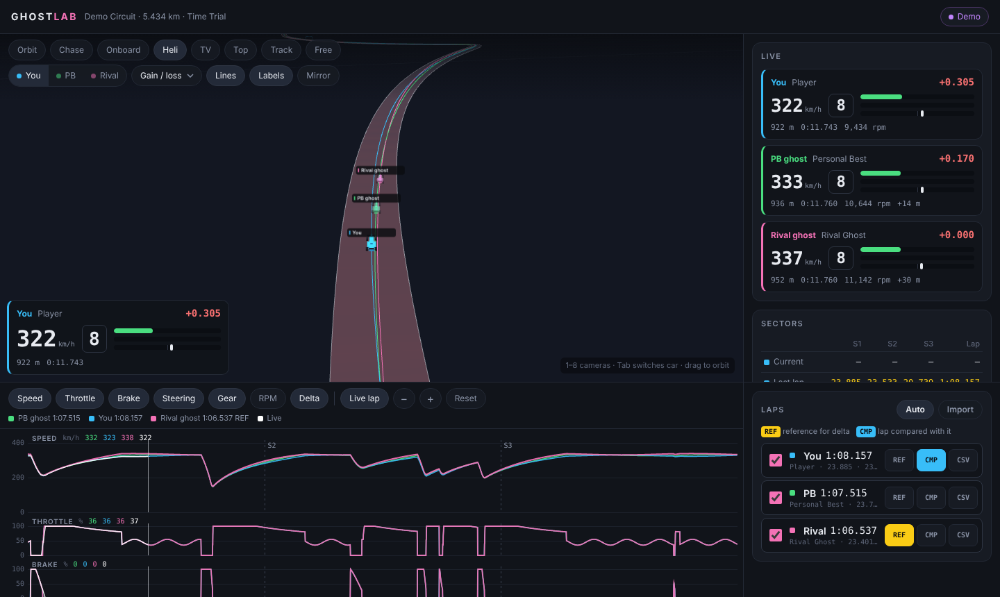

# Ghost Lab

**Live F1 26 / F1 25 time trial telemetry for your phone — race your rival's ghost with a 3D track map, sectors and lap traces.**



Ghost Lab picks out three cars from the game's UDP telemetry: **you**, your **personal-best ghost** and the **rival ghost**. It shows them live on a 3D map you can fly around, records every lap (the ghosts' too), and lines the laps up so you can see exactly where the rival gains time.

- **Detection screen.** Opens by finding the bridge, the game's telemetry, the session and the cars, then goes straight to the dashboard.
- **3D map.** The track is built from the cars' positions. 8 cameras: orbit, chase, onboard, helicopter, TV, top-down, overview and free. Colour the track by sector, speed, or where you gain or lose time.
- **Live data.** Speed, gear, throttle, brake, steering and live delta for all three cars.
- **Sectors.** Current, last lap, session best, PB and rival, coloured purple, green or yellow.
- **Traces.** Speed, throttle, brake, steering, gear, RPM and delta along the lap. Scrub with a finger, pinch to zoom.
- **Laps.** Every completed lap is saved as a CSV. Pick any lap as the reference (REF) and compare another (CMP) against it.
- **Phone first.** Tabbed layout, landscape support, add to home screen. On a desktop everything fits on one screen.



## How it works

```
 F1 26 (PC / PS5 / Xbox) ──UDP 20777──▶ bridge.py on a PC ──HTTP + WebSocket :8000──▶ phone / browser
```

Browsers can't receive UDP, so a small Python **bridge** runs on any PC on your network. It receives the game's packets, records the laps, and serves this web app to your phone. The bridge uses the Python standard library only, so there's nothing to install.

The copy of the app on GitHub Pages runs a **built-in demo** with simulated data, so anyone can try it without the game.

## Quick start

1. Install [Python 3.9+](https://www.python.org/downloads/) on a PC (Windows: tick "Add python.exe to PATH").
2. Download this repo (green **Code** button → **Download ZIP**) and unzip it.
3. Start the bridge from that folder:
   ```
   python bridge.py
   ```
   It opens the app on the PC and prints an **on your phone** address such as `http://192.168.1.20:8000`.
4. On your phone (same Wi-Fi), open that address, or scan the QR code on the PC's screen.
5. In the game, set up UDP telemetry (below), start a Time Trial, set a rival and drive. The detection screen lights up and the dashboard opens.

When Windows asks about the firewall, allow Python on **private networks**.

No game handy? Run `python bridge.py --demo`, or tap **Try the demo** in the app.

## Game settings

F1 26: **Settings → Telemetry Settings → UDP Telemetry Settings**

| Setting | Game on the same PC as the bridge | Console (PS5 / Xbox) |
|---|---|---|
| UDP Telemetry | On | On |
| UDP Broadcast Mode | Off | Off (or On and leave the IP alone) |
| UDP IP Address | `127.0.0.1` | the bridge PC's IP (shown in the app) |
| UDP Port | `20777` | `20777` |
| UDP Send Rate | 60 Hz | 60 Hz |
| UDP Format | 2026 | 2026 |

On F1 25 use format 2025. Formats 2023 and 2024 also work.

Ghosts only appear in **Time Trial**, with the PB and rival ghosts turned on.

## Putting it on GitHub

1. Create a new repository on GitHub and push this folder to it (on the `main` branch).
2. In the repo go to **Settings → Pages → Build and deployment → Source** and choose **GitHub Actions**.
3. The included workflow (`.github/workflows/pages.yml`) publishes the `web/` folder to `https://<you>.github.io/<repo>/`.

The Pages site runs the demo and gives phone visitors a field to enter their bridge address. **Live telemetry always comes through the bridge's own address** (`http://<PC-IP>:8000`). Browsers block a secure `https://` page from connecting to plain `ws://` devices on your home network, so the GitHub-hosted page can't talk to the bridge directly. The app hands you over to the right address when you enter it.

## Using the app

- **Status pill** (top right). Live / No telemetry / Bridge offline / Demo. Tap it to return to the detection screen.
- **Cameras.** Use the chips above the map. On a desktop, keys 1–8 switch camera and Tab switches which car you follow.
- **Follow.** You / PB / Rival picks which car the camera and the on-map panel follow.
- **Mirror.** Flips the map if a circuit ever comes out mirrored.
- **Traces.** On a phone, tap or drag sideways to read values (a yellow ring marks the spot on the 3D track), pinch to zoom, and double-tap to reset. On a desktop, hover, scroll to zoom and drag to pan.
- **Laps.** The checkbox shows a lap on the map and traces. REF sets the reference lap; CMP sets the lap compared against it. CSV downloads the lap. Import loads saved CSVs. Auto shows each car's newest lap and makes the rival the reference.

## Bridge options

```
python bridge.py --demo                   # simulated time trial
python bridge.py --port 20777             # game UDP port
python bridge.py --http-port 8000         # port the app is served on
python bridge.py --forward 127.0.0.1:20778  # pass packets on to another app (SimHub etc.)
python bridge.py --laps D:\f1laps         # where lap CSVs are saved (default ./laps)
python bridge.py --no-browser             # don't open the app on the PC
```

Only one program can listen on a UDP port. If you use another telemetry app too, point the game at Ghost Lab and pass packets on with `--forward`.

## Troubleshooting

| Detection screen says | Try |
|---|---|
| Looking for the bridge… | Is `bridge.py` running? On a phone, open the bridge's "on your phone" address, not the GitHub page. Phone and PC must be on the same Wi-Fi. Guest networks often block this. |
| Listening for the game… | Check the game settings above, then the firewall (allow Python on private networks). Telemetry only flows while you're on track. |
| Packets in an older format | Set UDP Format to 2026 (or 2025). |
| No ghosts yet | Use Time Trial, set a rival, and turn the ghosts on. |

## What ghost data can tell you

Ghost **inputs and motion** are solid: speed, throttle, brake, steering, gear, RPM, DRS and racing line. Tyre, ERS and fuel values for ghosts aren't meaningful, because ghosts are replays, so Ghost Lab doesn't use them. Ghost lap times come from the game's Time Trial packet when they match the recorded lap. Otherwise they're measured from the trace.

The game doesn't send track geometry, so the 3D track is built from the first complete lap.

## Project layout

```
bridge.py                  UDP receiver, lap recorder, web + WebSocket server, demo
web/index.html             the app
web/css/app.css            styles (phone first, desktop layout from 1024px)
web/js/app.js              detection, 3D map, panels, traces
web/js/demo.js             in-browser simulator used on GitHub Pages
web/vendor/                three.js r128, OrbitControls, qrcode-generator (MIT)
.github/workflows/pages.yml  publishes web/ to GitHub Pages
```

---

Ghost Lab is a fan-made tool and isn't affiliated with or endorsed by EA, Codemasters or Formula 1.
